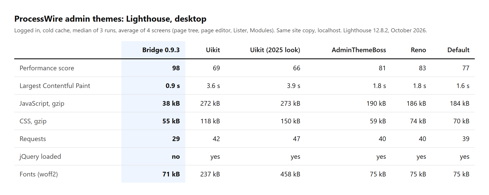

# Bridge

A [ProcessWire](https://processwire.com) admin built from native web components that still runs
every existing Inputfield and Process module.

The name says what it is: a bridge between the jQuery-era admin and the modern web stack.
"Bridge" is a working name. Status: beta, AdminThemeBridge 0.11.3; the component contract is
version 1 and may still change before 1.0.

## What it is

- **`AdminThemeBridge`**, an ordinary admin theme module for a stock ProcessWire 3
  (3.0.227+, PHP 8.1+). It renders the admin frame with its own markup and a small TypeScript
  runtime, without jQuery, in a light and a dark scheme with AdminThemeBoss's colour presets.
- **A legacy bridge.** jQuery, jQuery UI, `inputfields.js`, WireTabs and the rest of the
  upstream stack load only on screens that hold a jQuery-era Inputfield, Process or site script,
  with the old globals and events, so those modules keep working unchanged. A field that is
  collapsed until opened brings the stack only when it opens.
- **Native core screens.** Most core fields (text, select, checkboxes, toggle, datetime, page
  references, file, image with crop and variations, repeater, page table, language tabs) and the
  core Process screens (page tree, page editor, Lister, Modules, Fields, Templates, Users, Roles,
  Permissions, Profile, Logs, Trash and the rest) run natively. Edit forms save without a page
  reload; Shift+click saves the classic way.
- **A component contract** ([docs/contract.md](docs/contract.md)) that third-party modules can
  implement to run natively as well.
- **A bootstrap** ([bootstrap/](bootstrap/)) for running ProcessWire from any folder layout,
  with `wire/` kept as an untouched upstream copy.

Upstream `wire/` is never edited or patched. DOM ids and classes, AJAX endpoints, module class
names and hookable methods stay as upstream defines them, so modules and hooks find what they
expect. Design decisions are recorded in [docs/decisions/](docs/decisions/), changes in
[CHANGELOG.md](CHANGELOG.md).

## Lighter and faster

Lighthouse 12 (desktop preset), logged in, cold cache, median of 3 runs, average of four screens
(page tree, page editor, Lister, Modules) on the same copy of a real site
([tools/bench/](tools/bench/)):

<picture>
  <source media="(prefers-color-scheme: dark)" srcset="docs/images/benchmark-dark.png">
  
</picture>

The same for Bridge, Uikit and AdminThemeBoss as text:

| | Bridge 0.9.3 | Uikit | AdminThemeBoss |
|---|---:|---:|---:|
| Performance score | 98 | 69 | 81 |
| Largest Contentful Paint | 0.9 s | 3.6 s | 1.8 s |
| JavaScript, gzip | 38 kB | 272 kB | 190 kB |
| CSS, gzip | 55 kB | 118 kB | 59 kB |
| jQuery loaded | no | yes | yes |
| Fonts | 71 kB | 237 kB | 75 kB |

Localhost numbers: absolute times are higher on a real server, the differences between themes
are the point. A screen with a jQuery-era field loads that field's stack, as it should.

## Admin UX

- Multi-level dropdown menus stay open on the way to a submenu, fit the screen and open to the
  left at its right edge; on touch screens the first tap opens a menu, and menus work from the
  keyboard.
- Long content scrolls in place: a deep page-tree branch or a long menu scrolls inside itself
  instead of running off the screen.
- Notices have their own place above the content: they never cover the Save button, and
  showing or closing one does not move the page.
- No jumping content while the Lister loads, no tab panels flashing stacked before the tabs
  are set up; the top bar turns into a drawer when its items do not fit.
- The dark scheme reaches CKEditor, TinyMCE and the other field widgets; button text and focus
  rings meet the contrast checks in every colour preset, and every focus is visible under
  Windows high contrast.

## Compatibility

A conformance suite ([conformance/](conformance/)) renders every admin screen under Uikit and
under Bridge and compares what modules see. On copies of nine real sites that is 1,434 screens
with no difference caused by the theme, covering 41 of the 45 third-party modules installed
there; the other four have admin screens that fail the same way under Uikit on those copies
([conformance/RESULTS-2026-10-20.md](conformance/RESULTS-2026-10-20.md)). Behaviour checks run
in Chromium and Firefox. Pro modules (ProFields, FormBuilder, ListerPro) have not been tested.

## Install

1. Copy `modules/AdminThemeBridge/` to `site/modules/AdminThemeBridge/`.
2. Modules > Refresh, then install **Bridge**.
3. Select it under Profile > Admin Theme. Other users stay on their current theme.

On a live site, back up the database first and follow
[docs/install-live.md](docs/install-live.md). It covers modules that break a module cache
rebuild, and AdminThemeBoss's "activate for all users" setting, which blocks the selection.

To uninstall: switch your profile back to Uikit, then uninstall the module.

### Settings worth knowing

- **Native or legacy, per class.** One `ClassName=native` or `ClassName=legacy` per line,
  for an Inputfield or Process class: `native` runs it without the legacy stack (it must need
  neither jQuery nor `inputfields.js`), `legacy` always loads the stack where it renders.
- **Site scripts that never wait for the legacy stack.** On pages without jQuery, a site module
  script that calls jQuery waits until the stack loads (it would throw otherwise). If such a
  script works without jQuery, add a part of its URL (the module's directory name) here.
- **Legacy script stack:** load on demand (default) or always.

## For module authors

Implement the `BridgeComponent` interface and your Inputfield or Process runs natively; the
interface can be declared without the theme installed. Otherwise nothing changes: your module
gets the legacy stack, as today. A module can also add its own classes to the theme's native
map with a hook on `AdminThemeBridge::nativeMap`. Both are described in
[docs/contract.md](docs/contract.md).

## Development

```
bootstrap/                 front controller and project.php layout config
modules/AdminThemeBridge/  the admin theme; assets/dist/ and scripts/ hold built files (committed)
modules/BridgeDemo/        native Process and Inputfield used as a test fixture
runtime/                   TypeScript runtime, stylesheets (Vite) and the theme's classic
                           scripts (src/classic/, minified with esbuild into scripts/)
conformance/               screen-by-screen comparison against Uikit
tests/smoke.php            smoke test against a sandbox install
tools/                     sandbox builders, deploy and diagnostic scripts, Playwright checks,
                           bench/ (Lighthouse benchmark)
docs/                      component contract, ADRs, install notes
```

Build after changing anything in `runtime/src/` (the classic scripts included: the files in
`modules/AdminThemeBridge/scripts/` are build output):

```bash
cd runtime
npm install
npm run build
```

The build checks that the runtime, the stylesheets and each classic script stay within their
gzip size budgets and that every design token used is declared, and keeps the previous build's
chunks for one more release (a tab left open across a deploy still loads them).

Supported browsers: Chrome and Edge 111+, Safari 16.2+, Firefox 121+ (the CSS uses
`color-mix()` and `:has()`).

The ProcessWire modules directory installs from
[theoretic/AdminThemeBridge](https://github.com/theoretic/AdminThemeBridge), a module-only
repository generated from `modules/AdminThemeBridge/` with its history (the directory needs the
module file at a repository's root). Publish a release there with
`bash tools/release-module.sh` after committing it here.

### Font Awesome subsets

Core's Font Awesome 6 fonts carry every icon (about 300 kB); an admin screen shows a few dozen.
With `BRIDGE_WIRE` pointing at core's `wire/` directory, `npm run build` also cuts small subsets
of the icons in common use and writes `modules/AdminThemeBridge/assets/fonts/fa-<version>/`
(committed): `fa.css`, which the theme prints instead of core's `all.min.css`, the subsets (their
file names carry a content hash, so a re-cut subset is never served stale from a cache) and
copies of the full font files.

```bash
BRIDGE_WIRE=/path/to/wire npm run build
```

The subsets hold the icons used by core, by Bridge and by the names in `runtime/fa-icons.txt`.
Any other icon still renders: it comes from the full file, which the browser then fetches once.
Nothing can go missing; a rare icon only costs the full download. The theme uses the subsets
only for the Font Awesome version they were cut from and falls back to core's stylesheet
otherwise.

For one site, add its modules and the icons stored in its database (templates, fields, admin
pages) and deploy that build to it:

```bash
php tools/fa-icons-site.php /path/to/webroot > site-icons.txt
BRIDGE_WIRE=/path/to/wire BRIDGE_FA_SCAN=/path/to/webroot/site/modules \
  BRIDGE_FA_ICONS=site-icons.txt npm run build
```

`tools/fa-coverage.js` opens admin screens and lists the icons that still come from a full file.

### Tests

The sandbox and test tools build disposable copies of local ProcessWire sites under
`sandbox/` (gitignored); the header of each script in `tools/` describes it. `tests/smoke.php`
checks the theme against a sandbox from the command line, `conformance/run.php` compares every
screen with Uikit, and the Playwright checks in `tools/*-check.js` drive the screens in Chromium
and Firefox; each fails on page errors and on console errors. Never point the tests at a real
site's database.

## Credits

Bridge is mostly inspired by [AdminThemeBoss](https://github.com/noelboss/AdminThemeBoss) by
Noël Bossart: its colour presets are Bridge's colours, and its extended breadcrumbs are here too.

## License

Own code is [MIT](LICENSE). Files derived from ProcessWire keep their MPL 2.0 header and a
modification note; each file's header is authoritative. The PHP namespace stays `ProcessWire`.
